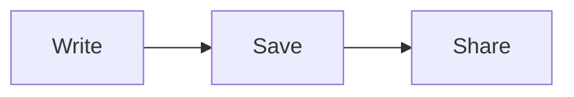

# Markdown reference

MarkdownPost understands GitHub Flavored Markdown and a few extras. This page shows every piece of syntax with the markdown on top and what it does underneath. The same rules apply in posts and in the About text on your profile.

The post **title is separate** from the body, so do not start the body with a `#` heading that repeats it.

## Text

```markdown
**bold**, *italic*, ***both***, ~~strikethrough~~, ==highlight==, `inline code`

A line ending in two spaces  
breaks without starting a new paragraph.
```

**bold**, *italic*, ***both***, ~~strikethrough~~, ==highlight==, `inline code`

A line ending in two spaces  
breaks without starting a new paragraph.

A blank line starts a new paragraph. Emoji shortcodes work: `:tada:` becomes :tada:, `:rocket:` becomes :rocket:.

Subscript and superscript are not markdown here, but the HTML tags work: `H<sub>2</sub>O` gives H<sub>2</sub>O and `x<sup>2</sup>` gives x<sup>2</sup>.

## Headings

```markdown
# Heading 1
## Heading 2
### Heading 3
#### Heading 4
```

Levels 1 to 6 work. **Levels 1 to 3 build the outline** (the "On this page" list and the table of contents on a post). Every heading gets a link you can share. Use `##` for your main sections, since the title already acts as the top level.

## Links

```markdown
[A link](https://example.com)
<https://example.com>
https://example.com
```

[A link](https://example.com), and web addresses that start with `http://` or `https://` become links by themselves. A bare `www.example.com` does not, so write the full address. Links with other schemes such as `javascript:` are not turned into links.

## Lists

```markdown
- A bullet
  - A nested bullet
- Another

1. First
2. Second
   1. Nested

- [x] A finished task
- [ ] A task still to do
```

- A bullet
  - A nested bullet
- Another

1. First
2. Second
   1. Nested

- [x] A finished task
- [ ] A task still to do

Task lists render as read-only checkboxes on the published page. (In the editor you can click them.)

## Quotes and alerts

```markdown
> A quote.

> [!NOTE]
> A note.

> [!TIP]
> A tip.
```

> A quote.

> [!NOTE]
> A note. Alerts are quotes whose first line is the marker.

> [!TIP]
> A tip.

> [!IMPORTANT]
> Something important.

> [!WARNING]
> Something that can go wrong.

> [!CAUTION]
> Something dangerous.

The five markers are `NOTE`, `TIP`, `IMPORTANT`, `WARNING` and `CAUTION`. The marker must be alone on the first line.

## Code

````markdown
```python
def greet(name):
    return f"Hello, {name}"
```
````

```python
def greet(name):
    return f"Hello, {name}"
```

Put a language after the opening fence for syntax highlighting (any language the Pygments library knows: `python`, `javascript`, `bash`, `json`, `yaml`, `sql`, `diff`, `html`, `css`, `go`, `rust` and many more). Without a language, or with one that is not recognised, the block is shown plain. Readers get a **Copy** button on each code block.

To show a fence inside a fence, wrap it in a longer one (four backticks, as above).

## Tables

```markdown
| Name   | Role    |  Count |
| :----- | :-----: | -----: |
| Ada    | Author  |     12 |
| Grace  | Editor  |      3 |
```

| Name   | Role    |  Count |
| :----- | :-----: | -----: |
| Ada    | Author  |     12 |
| Grace  | Editor  |      3 |

Colons in the divider row set alignment: `:---` left, `:---:` centre, `---:` right. Wide tables scroll sideways.

## Images

```markdown


```

Always write the description in the square brackets (it is read aloud by screen readers and shown if the image cannot load). Use `https://` addresses: pictures from plain `http://` addresses are blocked by the browser. Readers can click an image on a post to enlarge it. To host an image here, paste it into the editor; see [Images and files]({{origin}}/help/images/).

## Footnotes

```markdown
A claim that needs a source.[^1]

[^1]: The source goes here, and appears at the bottom of the post.
```

## Definition lists

```markdown
Term
: What it means.
```

Term
: What it means.

## Math

Inline math sits between single dollar signs, and display math between double dollar signs or in a `math` fence:

````markdown
Energy is $E = mc^2$ and a sum is:

$$
\sum_{i=1}^{n} i = \frac{n(n+1)}{2}
$$
````

Energy is $E = mc^2$ and a sum is:

$$
\sum_{i=1}^{n} i = \frac{n(n+1)}{2}
$$

Math is drawn with KaTeX in the reader's browser. If a formula cannot be drawn, its source stays visible.

> [!NOTE]
> A plain price such as `$5` or `$10` is left alone. A dollar sign followed by a space or a letter can start a formula, and a second dollar sign later in the same paragraph ends it. If a stray dollar sign turns text into math, write a backslash before it: `\$`.

## Diagrams

````markdown

````


Any [Mermaid](https://mermaid.js.org) diagram type works: flowcharts, sequence diagrams, pies, Gantt charts and more. Diagrams follow the light or dark look of the page. If the diagram has a mistake, the source stays visible with the error as a tooltip.

## Horizontal rule

```markdown
---
```

Three dashes on a line of their own draw a divider.

## Collapsible sections and a safe slice of HTML

```html
<details>
<summary>Click to open</summary>

Hidden text, which can contain **markdown** after the blank line.

</details>
```

<details>
<summary>Click to open</summary>

Hidden text, which can contain **markdown** after the blank line.

</details>

Raw HTML is allowed the way GitHub allows it: it is parsed and then cleaned. What survives is a safe set of tags, such as `details`, `summary`, `kbd` (<kbd>Ctrl</kbd> + <kbd>S</kbd>), `mark`, `sub`, `sup`, `abbr`, `figure`, `ins`, `del`, `br`, `center` and the ones markdown already produces. `align="center"` works on paragraphs, headings, divs and images. Scripts, iframes, forms, styles, inline `style` attributes (other than table alignment) and event handlers such as `onclick` are removed. Only the classes and ids the renderer itself makes are kept, so a post cannot borrow the site's own styles.

## Front matter

If a post starts with a block between two `---` lines, it is shown as a small two-column table at the top, the way GitHub shows it:

```markdown
---
status: draft
audience: friends
---
```

Each `key: value` line becomes a row. It is display only; nothing reads it as settings.

## What is not supported

- Custom CSS and `<style>` tags.
- Embedded video and iframes.
- @mentions.
- Subscript or superscript in markdown syntax (use `<sub>` and `<sup>`).

## Good to know

- Posts can be up to 500,000 bytes.
- Search finds words in the first 20,000 characters of a post.
- A post's short preview (the excerpt shown in lists) is the first 200 characters of its plain text.
- The raw markdown of any visible post is at `/@name/<id>.md`.
